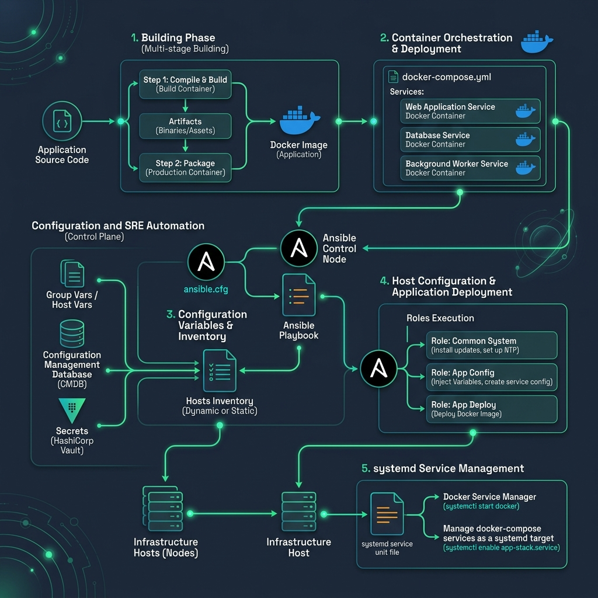

# 🚦 Nginx Configurator
> Build production-grade nginx.conf files. Configure upstreams, rate limiters, security headers, SSL, compression, and visualize live traffic routing flowcharts via dynamic Mermaid diagrams.

[](https://pradeeptalari.me/tools/nginx-config/)
[]()
[](https://pradeeptalari.me/projects/)
[](https://pradeeptalari.me/tools/repo-learning/)

---

## 🎛️ How This Studio Works

Build production-grade nginx.conf files. Configure upstreams, rate limiters, security headers, SSL, compression, and visualize live traffic routing flowcharts via dynamic Mermaid diagrams.

Open the **[Interactive Studio](${studioUrl})** to configure options and generate files.
Each option combination produces different output — try different settings to learn by example.

## 🏗️ Architecture Flow Diagram



## 🔄 Workflow

```
1. Open Studio → https://pradeeptalari.me/tools/nginx-config/
2. Configure all parameters (options change the generated output)
3. Review the live output in the editor tabs
4. Download or Copy the generated files
5. Place files in your project repository
6. Run the execution command shown in the studio
7. Validate with the verification command
```

## ⚡ Quick Start

```bash
git clone https://github.com/Pradeeptalari14/tp-nginx-config.git
cd tp-nginx-config
# Browse examples/ for reference configurations
```

## 🔐 Security

- ❌ Never commit real credentials
- ✅ Use environment variables or secret managers
- ✅ Enable branch protection on `main`

## 📖 Resources

| Resource | Link |
|----------|------|
| Interactive Studio | [Open →](https://pradeeptalari.me/tools/nginx-config/) |
| All 91 Studios | [Dashboard →](https://pradeeptalari.me/tools/) |

*Part of [Talari Pradeep Developer Studio Portfolio](https://pradeeptalari.me)*

---
*Synchronized with [Nginx Configurator Studio](https://pradeeptalari.me/tools/nginx-config/) & [Repository Learning DAG](https://pradeeptalari.me/tools/repo-learning/) — [Talari Pradeep Portfolio](https://pradeeptalari.me)*
